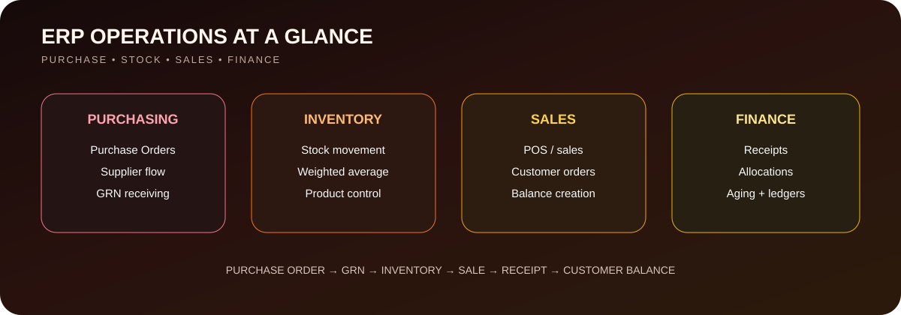
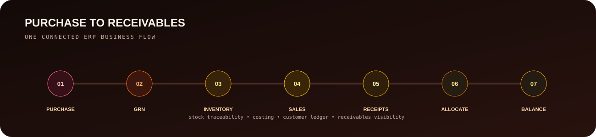

<p align="center">
  
</p>

<p align="center"><b>Purchasing • inventory • sales • receivables in one connected ERP flow</b></p>

<p align="center">
  
  
  
</p>

## ✦ ERP Module Map

<p align="center">
  
</p>

## ✦ End-to-End Business Flow

<p align="center">
  
</p>

## What It Solves

The ERP connects the operational journey from purchasing stock to receiving customer payments, giving better traceability across inventory and finance.

### Main Modules
- Product and master data
- Purchase Orders + GRN
- Weighted-average inventory costing
- Sales / POS
- Customer receipts and allocations
- Customer advances and ledgers
- Receivables aging

## Why This Project Matters

- Connects stock movement with financial balances
- Tracks purchase-to-sale operations clearly
- Uses structured database design and migrations
- Includes project, database, module and release documentation

## Repository Context

This is a **forked/collaborative codebase**. Individual contribution should be explained using commit and collaboration history rather than presenting the full codebase as single-author work.

## Run Locally

```bash
composer install
php artisan key:generate
php artisan migrate --seed
php artisan test
```

## Documentation

[`DEVELOPMENT_PLAN.md`](DEVELOPMENT_PLAN.md) · [`DATABASE_DESIGN.md`](DATABASE_DESIGN.md) · [`MODULES.md`](MODULES.md) · [`RELEASE_CHECKLIST.md`](RELEASE_CHECKLIST.md)

---

<p align="center"><b>Purchase → stock → sale → payment → customer balance.</b></p>
